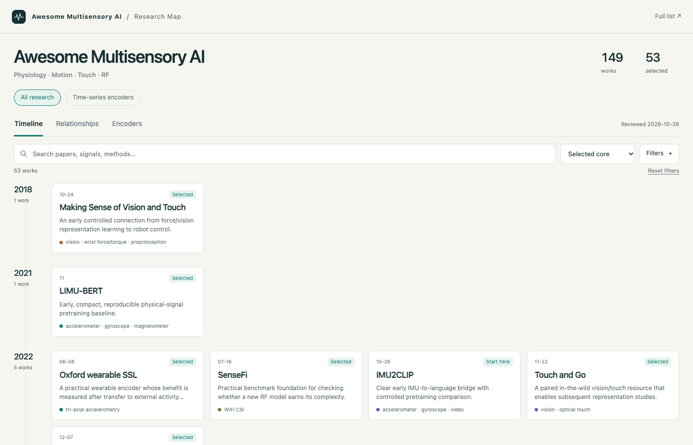

# Awesome Multisensory AI 

> **Beyond vision: physical sensor signals as first-class modalities in multimodal AI.**
> A curated collection of **sensor foundation models**, **multimodal alignment** methods, **physical state understanding**, **sensor-driven action**, and **datasets and benchmarks** for physiological signals (PPG, ECG, EEG, EMG, CGM), motion (IMU), touch and force, and radio-frequency sensing. Maintained by [DUVA Research](https://github.com/open-duva).

**53 core selections · 37 background references**, plus a separate [further-reading list](resources/watchlist.md).

**[Open the interactive Research Map →](https://open-duva.github.io/awesome-multisensory-ai/)** Timeline, research connections, and encoder comparison. Select a work to inspect inputs, demonstrated capability, evaluation reference, generalization, and limitations. The same page ships in the repository as [`atlas/dist/index.html`](atlas/dist/index.html) and works offline.

## Contents

- [Why this list](#why-this-list)
- [Start here](#start-here)
- [Research topics](#research-topics)
- [Focus: general time-series encoders](#focus-general-time-series-encoders)
- [Further reading](#further-reading)
- [Datasets, benchmarks, and tools](#datasets-benchmarks-and-tools)
- [Scope and contributions](#scope-and-contributions)
- [Related lists](#related-lists)
- [Contributing](#contributing)
- [Citation and license](#citation-and-license)

## Why this list

This repository is a curated resource list, with source-backed summaries, comparisons, and reading paths.

Most multimodal AI treats the world through cameras and microphones. Physiology, motion, proprioception, touch, force, and radio signals expose states that scene vision cannot resolve: cardiac rhythm, sleep stages, glucose trajectories, contact force, slip, or a person moving behind a wall.

This list tracks the work that makes such measurements **reusable inputs for machine learning**:

- **Representations:** single-sensor foundation models, specialist encoders, shared embeddings, and adapters.
- **Integration:** sensor-language, sensor-vision, and RF-vision interfaces, with alignment kept separate from physical truth.
- **Understanding and action:** calibrated state estimation, tool-using agents, tactile and force feedback, and world-model planning with explicit outcome boundaries.
- **Evidence:** datasets, independent benchmarks, and negative results that test whether a sensor actually helps.

Detailed entries distinguish raw samples, processed waveforms, derived features, and daily aggregates. Generic forecasting, ordinary audiovisual fusion, hardware catalogs, and vision-only models stay outside the core scope.

## Start here

| Question | Representative work | Contribution |
| --- | --- | --- |
| How do raw signals become reusable representations? | [PaPaGei](topics/sensor-representations.md#papagei), [ECG-FM](topics/sensor-representations.md#ecg-fm), [BIOT](topics/sensor-representations.md#biot) | Physical-domain encoders, explicit adaptation protocols, and open implementations. |
| What changes beyond short physiological windows? | [SleepFM clinical](topics/sensor-representations.md#sleepfm-clinical), [GluFormer](topics/sensor-representations.md#gluformer) | Multichannel sleep and glucose trajectories, with distinct external-cohort and device-transfer evidence. |
| How do sensors connect to language? | [ImageBind](topics/multimodal-integration.md#imagebind), [SensorLM](topics/multimodal-integration.md#sensorlm), [OpenTSLM](topics/multimodal-integration.md#opentslm) | Different integration routes; semantic alignment and physical inference remain separate claims. |
| What does touch measure beyond appearance? | [Sparsh-X](topics/sensor-representations.md#sparsh-x), [GenForce](topics/physical-understanding.md#genforce) | Multiple contact channels and cross-technology force calibration. |
| Does another sensor improve executed behavior? | [FoAR](topics/dynamics-and-action.md#foar), [3D-ViTac](topics/dynamics-and-action.md#3d-vitac), [Generic neuromotor interface](topics/dynamics-and-action.md#generic-neuromotor-interface) | Force and tactile feedback and EMG-driven interaction with explicit outcome boundaries. |
| Where does the approach fail? | [SensorBench](topics/datasets-and-benchmarks.md#sensorbench), [EEG-FM-Compass](topics/datasets-and-benchmarks.md#eeg-fm-compass), [PPG-Bench](resources/watchlist.md#ppg-bench) (preprint) | Executable quantitative tests and specialist controls. PPG-Bench is a recent preprint listed under further reading. |

## Research topics

| Research problem | Core entries | Entry point |
| --- | ---: | --- |
| Representation and pretraining | 20 | [Physiology, motion, and tactile encoders](topics/sensor-representations.md) |
| Multimodal alignment and integration | 15 | [Sensor-language, vision, and RF interfaces](topics/multimodal-integration.md) |
| Physical state understanding and reasoning | 5 | [State estimation, calibrated force, and tools](topics/physical-understanding.md) |
| Dynamics and action | 7 | [Feedback, policies, and qualified world-model planning](topics/dynamics-and-action.md) |
| Datasets and evaluation contributions | 6 | [Reusable resources and independent tests](topics/datasets-and-benchmarks.md) |

[Background methods](topics/background.md) (37 entries) provide controls and documented technical ancestors, including the general time-series encoders and the first wearable-scale biosignal foundation models.

## Focus: general time-series encoders

The [22-entry encoder comparison](resources/encoder-comparison.md) covers reusable training methods, shared pretrained encoders, multitask backbones, and forecasting-derived features. Start with TS2Vec, MOMENT, Mantis/MantisV2, TSPulse, NuTime, and UniTS for complementary approaches. Shared weights and calibrated physical understanding are different capabilities.

## Further reading

See [further reading](resources/watchlist.md) for additional publications and primary-source links, listed separately from the core collection.

## Datasets, benchmarks, and tools

- [Dataset index](resources/datasets.md): measurement metadata, synchronization, split guidance, and access terms.
- [Benchmark index](resources/benchmarks.md): what each benchmark actually measures and what information each baseline receives.
- [Code and tools](resources/tools.md): official implementations, checkpoints, and evaluation harnesses, with access notes.
- [BibTeX](references.bib) for every core and background entry.

## Scope and contributions

The list covers learning, interpretation, and action using physical sensor signals. Single-sensor methods are welcome. Entries describe the contribution, demonstrated capability, limitations, and primary sources. Generic forecasting, ordinary audiovisual fusion, and hardware-only catalogs are outside the main scope.

To suggest a resource or correct an entry, see [Contributing](CONTRIBUTING.md).

## Related lists

- [Awesome Time Series and Spatio-Temporal LLMs](https://github.com/qingsongedu/Awesome-TimeSeries-SpatioTemporal-LM-LLM) for forecasting-oriented foundation models.
- [Awesome Tactile Perception](https://github.com/xiaoen0/Awesome-Tactile-Perception) for tactile hardware and perception.
- [Awesome Foundation Models for Robotics](https://github.com/cagbal/awesome-foundation-models-for-robotics) for vision-centric robot policies.

## Contributing

Suggest a work with the [resource suggestion](.github/ISSUE_TEMPLATE/suggest-resource.yml) form or report an error with the [correction](.github/ISSUE_TEMPLATE/correction.yml) form. Include a primary source, scope rationale, the actual measurements, the demonstrated capability, and one meaningful limitation. See [CONTRIBUTING.md](CONTRIBUTING.md) for the entry format and checks.

## Citation and license

If this collection helps your research, cite it as:

~~~bibtex
@misc{awesome-multisensory-ai,
  title  = {Awesome Multisensory AI: Physical Sensing for Multimodal Intelligence},
  author = {{DUVA Research}},
  year   = {2026},
  url    = {https://github.com/open-duva/awesome-multisensory-ai}
}
~~~

Original curation is licensed under [CC BY 4.0](LICENSE); maintenance scripts and the research map code use the [MIT License](LICENSE-CODE). Linked papers, software, weights, and datasets retain their own terms. Inclusion implies neither affiliation nor independent reproduction.
